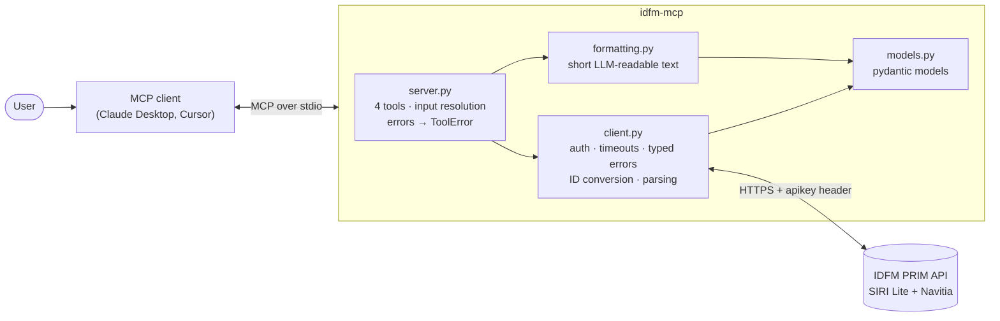

# idfm-mcp

[](https://github.com/Drathod-24/idfm-mcp/actions/workflows/ci.yml)


**An open-source MCP server that lets any AI assistant (Claude Desktop, Cursor, …) answer real-time questions about Paris public transport, using the official Île-de-France Mobilités PRIM API.**

> "When is the next RER B from Gentilly?" · "Are there disruptions on Metro line 7?" · "How do I get from Bastille to Orly at 18:30?"

<!-- Demo GIF: record Claude Desktop answering a question, save as docs/demo.gif -->


## Tools

| Tool | What it does | PRIM API |
|---|---|---|
| `search_stop(query)` | Find stations by name, with their IDs and lines | Navitia `/places` |
| `next_departures(stop_id, line=None)` | Real-time departures: line, destination, minutes to wait, delay, platform | SIRI Lite `/stop-monitoring` |
| `plan_journey(from_place, to_place, departure_time=None)` | Up to 3 routes with duration, transfers and steps | Navitia `/journeys` |
| `traffic_disruptions(line=None)` | Current and planned incidents/works, most severe first | Navitia `/line_reports` |

## Architecture



Each layer has one job: `client.py` is the only code that knows HTTP and raw JSON;
`server.py` is the only code that knows MCP; `formatting.py` decides what the LLM reads.
See [docs/prim-api.md](docs/prim-api.md) for the API details and gotchas.

## Install

Requirements: [uv](https://docs.astral.sh/uv/) and a free PRIM API key.

```bash
git clone https://github.com/Drathod-24/idfm-mcp.git
cd idfm-mcp
uv sync
cp .env.example .env    # then paste your key into .env
```

**Get a key:** create an account on [prim.iledefrance-mobilites.fr](https://prim.iledefrance-mobilites.fr),
open *Mes jetons d'authentification* → *API* → *Générer mon jeton*. The token is shown only once.

## Use with Claude Desktop

Open *Settings → Developer → Edit Config* (`claude_desktop_config.json`) and add:

```json
{
  "mcpServers": {
    "idfm": {
      "command": "uv",
      "args": ["--directory", "/absolute/path/to/idfm-mcp", "run", "idfm-mcp"],
      "env": { "IDFM_API_KEY": "your-prim-api-key" }
    }
  }
}
```

On Windows, use a path like `"C:\\Users\\you\\idfm-mcp"`. Restart Claude Desktop; the
tools appear under the 🔌 icon. (`env` is optional if the key is already in `.env`.)

Cursor uses the same JSON in `~/.cursor/mcp.json`.

## Test with MCP Inspector

```bash
# Interactive web UI
npx @modelcontextprotocol/inspector uv --directory . run idfm-mcp

# Or scripted (CLI mode)
npx @modelcontextprotocol/inspector --cli uv --directory . run idfm-mcp --method tools/list
npx @modelcontextprotocol/inspector --cli uv --directory . run idfm-mcp \
  --method tools/call --tool-name search_stop --tool-arg query=Gentilly
```

## Example questions and answers

These are the tools' real output formats, produced from the test fixtures (times are illustrative):

**"When is the next RER B from Gentilly?"** → `next_departures(stop_id="Gentilly", line="RER B")`
```
Next departures at Gentilly (stop_area:IDFM:63244) (now 09:25):
- RER B → Aéroport CDG 2 TGV: now, 09:26
- RER B → Saint-Rémy-lès-Chevreuse: in 8 min, 09:33 (+2 min vs schedule, platform 2)
```

**"Are there disruptions on Metro line 7?"** → `traffic_disruptions(line="Metro 7")`
```
1 disruption(s) for Métro 7:
- [Métro 7] Métro 7 : trafic perturbé — reduced service
  En raison de travaux, le trafic est interrompu entre Place d'Italie et Villejuif. Des bus de remplacement sont mis en place.
  Until 05/11 23:00
(1 elevator/escalator notices not shown.)
```

**"How do I get from Gentilly to Étoile at 9:30?"** → `plan_journey(from_place="Gentilly", to_place="Étoile", departure_time="09:30")`
```
Routes from Gentilly to Étoile:

Option 1: 09:30 → 10:02 (32 min, 1 transfer)
  1. Walk 4 min to Gentilly
  2. RER B toward Aéroport CDG 2 TGV: Gentilly → Châtelet les Halles (09:34–09:45)
  3. Change: walk 5 min to Châtelet
  4. Métro 1 toward La Défense: Châtelet → Charles de Gaulle - Étoile (09:50–10:02)
```

**Errors are answers too:** a missing key, a bad stop ID, a 429 quota error or a timeout
comes back as a clear MCP error (`isError: true`), never a crash:
```
IDFM API quota exceeded (default: 5 requests/second, 1000/day). Wait a bit before retrying.
```

## Development

```bash
uv run pytest                # 68 tests; every PRIM call is mocked with respx, no key needed
uv run pytest -m live        # optional: ~5 real calls to check fixtures match the real API
uv run ruff check . && uv run ruff format --check .
```

CI (GitHub Actions) runs ruff, pytest and the eval dataset check on Python 3.11–3.13 on every push.

## Evals

[`evals/questions.json`](evals/questions.json) has 20 natural-language questions (English
and French, plus one off-topic) with the acceptable first tool call for each. The runner
reads the tool definitions **from the server itself**, asks Claude which tool it would
call, and scores tool name + arguments. It tests the docstrings, which are what an LLM
actually sees.

```bash
uv run python evals/run_evals.py --offline          # validate the dataset (runs in CI)
uv run --group evals python evals/run_evals.py      # live run, needs ANTHROPIC_API_KEY
```

| Category | Cases | Passed |
|---|---|---|
| Next departures | 6 | _pending_ |
| Stop search | 3 | _pending_ |
| Journey planning | 5 | _pending_ |
| Disruptions | 5 | _pending_ |
| Off-topic (no tool) | 1 | _pending_ |
| **Total** | **20** | _pending_ |

Full per-question results: [evals/results.md](evals/results.md). _The live eval has not been run yet._

## Limitations

- **Real-time coverage is partial**: PRIM does not provide live data for every stop yet; an empty list is a normal answer.
- **Default quota is 1,000 requests/day per API.** `next_departures` uses 1–3 calls (name lookup, line names, departures). There is no caching yet.
- **Test fixtures are synthetic**, built from the docs; run `pytest -m live` with a key to check them against the real API.
- **Line resolution is heuristic**: a bare number ("7") is assumed to be a Metro line.
- `plan_journey` takes the best match for free-text places and does not ask when names are ambiguous.
- The eval tests only the **first** tool call, not multi-turn conversations or answer quality.

## Next steps

- [ ] Cache stop/line lookups (they rarely change) to save quota
- [ ] Record real API responses as fixtures
- [ ] Multi-turn evals: score the final answer, not just the routing
- [ ] Streamable HTTP transport for remote deployment
- [ ] Accessibility: expose elevator outages as their own tool
- [ ] Publish to PyPI so it runs with `uvx idfm-mcp`

## License

MIT. Data from Île-de-France Mobilités via PRIM, under the [Mobility License](https://prim.iledefrance-mobilites.fr) / ODbL.
This project is not affiliated with Île-de-France Mobilités, RATP or SNCF.
